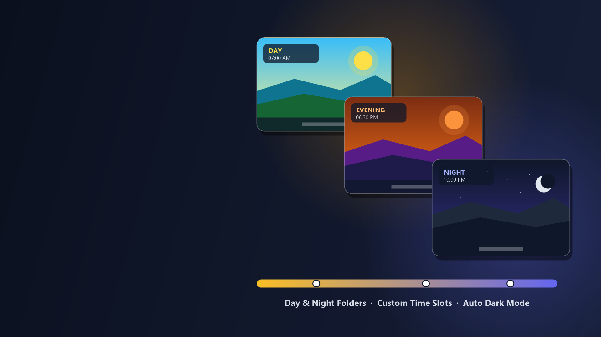
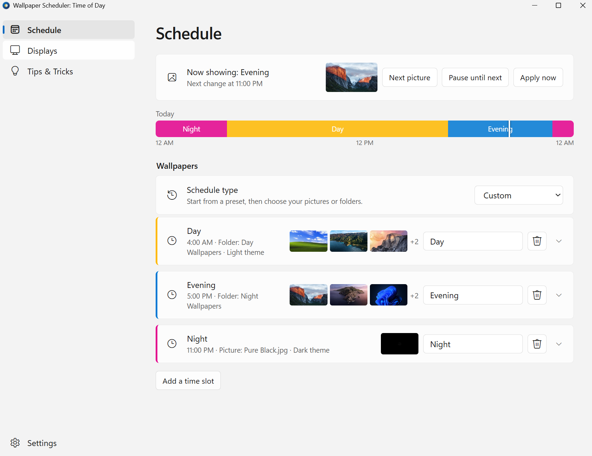
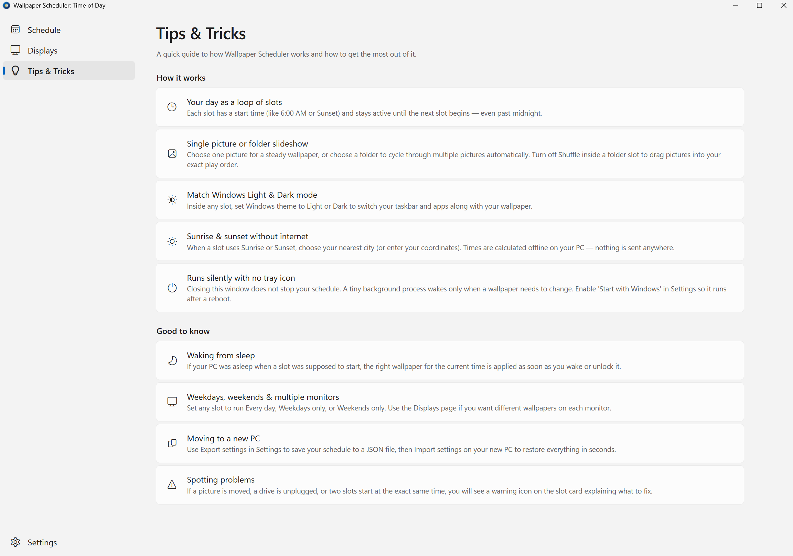

# Wallpaper Scheduler: Time of Day

A tiny (~0.6 MB), native Windows 11 utility that automatically switches your desktop wallpapers — and optionally your Windows Light/Dark theme — by time of day or sunrise and sunset.

**Free. Open source (GPLv3). No ads, no accounts, no tracking, no internet access.**

## Download

- **Microsoft Store (recommended):** [apps.microsoft.com/detail/9N6PCZ8Z74LN](https://apps.microsoft.com/detail/9N6PCZ8Z74LN)
- **Direct Portable Download (no Store needed):** [Latest GitHub Release (`.zip`)](https://github.com/Aussie-App-Studio/wallpaper-scheduler/releases/latest) — download, extract, and double-click `WallpaperScheduler.exe`.
- **Landing & Privacy Page:** [aussie-app-studio.github.io/wallpaper-scheduler](https://aussie-app-studio.github.io/wallpaper-scheduler/)

---

## Features

- **Day & Night or custom time slots:** Switch between folders or single pictures at exact times, or automatically at **Sunrise** and **Sunset** (with optional minute offsets).
- **Windows Light & Dark theme sync:** Optionally switch Windows between Light and Dark mode whenever a slot begins.
- **Folder slideshows with custom play order:** Preview every picture in your folder, drag thumbnails to set the exact order, or enable shuffle.
- **Weekday & weekend schedules:** Run slots every day, weekdays only, or weekends only.
- **Multi-monitor support:** Use the same wallpaper everywhere or customize each display.
- **Offline solar calculation:** Sunrise and sunset are calculated locally on your PC using the NOAA solar algorithm (choose a nearby city or enter custom coordinates).
- **Backup & transfer:** Export your schedule to a JSON file and import it on any new PC in seconds.
- **Ultra-lightweight:** Native Rust UI + Rust background agent (~0.6 MB download, ~1.3 MB installed, ~2.5 MB RAM & 0% CPU while sleeping until the next transition).

---

## Screenshots

| Schedule | Tips &amp; Tricks |
| :---: | :---: |
|  |  |

---

## Privacy & Transparency

Wallpaper Scheduler: Time of Day declares **no internet capability** in [`Package.appxmanifest`](src/WallpaperScheduler.Package/Package.appxmanifest). Everything runs locally on your PC, and settings are stored in `%LocalAppData%\WallpaperScheduler\config.json`.

See [docs/privacy.html](docs/privacy.html) for the full privacy statement.

---

## License

Licensed under the **GNU General Public License v3.0 (GPLv3)** — see [LICENSE](LICENSE). Any modified or redistributed versions must remain open source under the same license.
